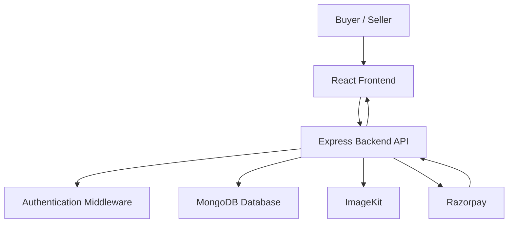

# Tivyro — Fashion E-Commerce Platform

<p align="center">
  
  
  
  
</p>

**Tivyro** is a full-stack fashion e-commerce platform designed to provide a seamless online shopping experience for buyers and a dedicated product management experience for sellers.

The platform brings together product discovery, shopping cart management, authentication, inventory handling, and online payments into one application.

🌐 **Live Demo:** [https://tivyro.vercel.app/](https://tivyro.vercel.app/)

---

## Table of Contents

- [Overview](#overview)
- [Features](#features)
- [Payment Integration](#payment-integration)
- [Tech Stack](#tech-stack)
- [Application Architecture](#application-architecture)
- [Getting Started](#getting-started)
- [Environment Variables](#environment-variables)
- [Project Structure](#project-structure)
- [Future Improvements](#future-improvements)

## Overview

Tivyro is built around two user roles:

### 🛒 Buyer

Buyers can explore fashion collections, view product details, select product variants, manage their shopping cart, and complete purchases through Razorpay.

### 🏪 Seller

Sellers can create and manage their fashion products, upload product images, add product variants, and manage product-specific pricing and stock information.

The application uses role-based authentication to provide separate experiences for buyers and sellers.

## Features

### 🛍️ Product Discovery & Shopping

- Browse men's and women's fashion collections.
- Explore detailed product information.
- View product images and variants.
- Search for products.
- Add products to the shopping cart.
- Increment or decrement cart item quantities.
- Validate product variants and stock availability.
- Calculate cart totals dynamically.

### 👤 Authentication & Authorization

- User registration and login.
- Google OAuth authentication.
- JWT-based authentication.
- Buyer and seller roles.
- Protected routes for authenticated users.
- Seller-specific authorization middleware.

### 🏪 Seller Dashboard

- Dedicated seller dashboard.
- Create fashion products.
- Upload multiple product images.
- Add product variants.
- Manage variant-specific pricing and stock.
- View seller-owned products.
- Access seller product details.

### 💳 Razorpay Payment Integration

Razorpay integration is one of the major features of Tivyro.

The application implements a backend-connected payment workflow to provide a reliable checkout experience.

**Payment workflow:**

1. The buyer initiates checkout.
2. The backend creates a Razorpay order.
3. Order details are stored in MongoDB.
4. Razorpay Checkout is opened on the frontend.
5. The buyer completes the payment.
6. Razorpay returns the payment details and signature.
7. The backend verifies the payment signature using the Razorpay secret.
8. The payment status is updated in MongoDB.
9. The buyer is redirected to the order confirmation experience.

**Key implementation details:**

- Razorpay Checkout integration.
- Server-side Razorpay order creation.
- Backend payment verification.
- Signature validation using Razorpay utilities.
- Payment and order information persistence.
- Order confirmation page.
- Order details retrieval for authenticated users.

The backend is responsible for payment verification rather than relying solely on the frontend response.

### 📊 MongoDB Aggregation Pipeline

Tivyro uses MongoDB Aggregation to process cart data and calculate the total price of the cart.

The aggregation pipeline includes:

- `$match` — Filter the cart belonging to the authenticated user.
- `$unwind` — Process individual cart items.
- `$lookup` — Retrieve product information from men's and women's product collections.
- `$addFields` — Combine product information and calculate item prices.
- `$group` — Calculate the overall cart total and organize cart items.

This allows the backend to retrieve product and variant information and calculate the cart total through a multi-stage aggregation pipeline.

### 📱 Responsive User Interface

- Responsive layouts for different screen sizes.
- Modern fashion-focused design.
- Interactive navigation.
- Product browsing and checkout interfaces.

---

## Tech Stack

| Category | Technologies |
|---|---|
| Frontend | React.js, Tailwind CSS |
| Routing | React Router |
| State Management | Redux Toolkit, React Redux |
| Backend | Node.js, Express.js |
| Database | MongoDB, Mongoose |
| Authentication | JWT, Google OAuth 2.0 |
| Payments | Razorpay |
| Image Storage | ImageKit |
| API Communication | Axios |
| Deployment | Vercel, Render |

---

## Application Architecture

Tivyro follows a client-server architecture.



The frontend communicates with the backend through REST APIs. The backend handles authentication, product operations, cart processing, database interactions, and payment verification.

---

## Getting Started

Follow these steps to run Tivyro locally.

### Prerequisites

Make sure you have installed:

- Node.js
- npm
- MongoDB Atlas account or a local MongoDB instance
- Google OAuth credentials
- ImageKit credentials
- Razorpay test account credentials

### 1. Clone the Repository

```bash
git clone https://github.com/YOUR_USERNAME/YOUR_REPOSITORY.git
```

```bash
cd YOUR_REPOSITORY
```

Replace the repository URL with your actual GitHub repository URL.

### 2. Install Backend Dependencies

```bash
cd Backend
npm install
```

### 3. Configure Backend Environment Variables

Create a `.env` file inside the `Backend` directory.

```env
MONGO_URI=your_mongodb_connection_string

JWT_SECRET=your_jwt_secret

GOOGLE_CLIENT_ID=your_google_client_id
GOOGLE_CLIENT_SECRET=your_google_client_secret
GOOGLE_OAUTH_CALLBACK_URL=http://localhost:3000/api/auth/google/callback

FRONTEND_URL=http://localhost:5173

IMAGEKIT_PRIVATE_KEY=your_imagekit_private_key

RAZORPAY_KEY_ID=your_razorpay_key_id
RAZORPAY_KEY_SECRET=your_razorpay_key_secret

NODE_ENV=development
```

**Important:** Use your own credentials. Never commit your `.env` file or expose private keys in your repository.

### 4. Start the Backend

From the `Backend` directory:

```bash
npm run dev
```

The backend will run on the configured server port.

### 5. Install Frontend Dependencies

Open a new terminal:

```bash
cd Frontend
npm install
```

### 6. Configure Frontend Environment Variables

Create a `.env` file inside the `Frontend` directory.

```env
VITE_API_URL=http://localhost:3000
```

The frontend uses this variable to communicate with the backend API.

### 7. Start the Frontend

```bash
npm run dev
```

Open the local URL provided by Vite, usually:

```text
http://localhost:5173
```

---

## Environment Variables

### Backend

| Variable | Description |
|---|---|
| `MONGO_URI` | MongoDB connection string |
| `JWT_SECRET` | Secret used for JWT authentication |
| `GOOGLE_CLIENT_ID` | Google OAuth client ID |
| `GOOGLE_CLIENT_SECRET` | Google OAuth client secret |
| `GOOGLE_OAUTH_CALLBACK_URL` | Google OAuth callback URL |
| `FRONTEND_URL` | Frontend URL used for CORS and redirects |
| `IMAGEKIT_PRIVATE_KEY` | ImageKit private key |
| `RAZORPAY_KEY_ID` | Razorpay API key ID |
| `RAZORPAY_KEY_SECRET` | Razorpay API secret |
| `NODE_ENV` | Application environment |

### Frontend

| Variable | Description |
|---|---|
| `VITE_API_URL` | Backend API base URL |

---

## Project Structure

```text
Tivyro/
│
├── Backend/
│   ├── src/
│   │   ├── config/
│   │   ├── controllers/
│   │   ├── dao/
│   │   ├── middlewares/
│   │   ├── models/
│   │   ├── routes/
│   │   ├── services/
│   │   └── validator/
│   │
│   ├── server.js
│   └── package.json
│
├── Frontend/
│   ├── src/
│   │   ├── app/
│   │   ├── config/
│   │   └── features/
│   │       ├── auth/
│   │       ├── cart/
│   │       ├── products/
│   │       └── Shared/
│   │
│   └── package.json
│
└── README.md
```

---

## Future Improvements

- Order history and order tracking.
- Seller sales analytics.
- Product reviews and ratings.
- Wishlist functionality.
- Advanced filtering and sorting.
- Enhanced inventory management.
- Automated email notifications.

---

## Learning Outcomes

Building Tivyro helped me gain practical experience with:

- Developing a complete MERN stack application.
- Implementing buyer and seller role-based functionality.
- Integrating third-party payment services.
- Handling payment verification on the backend.
- Designing MongoDB aggregation pipelines.
- Managing application state using Redux Toolkit.
- Connecting frontend components with backend APIs.
- Structuring a full-stack application using modular architecture.

---

## Live Project

🌐 **Explore Tivyro:** [https://tivyro.vercel.app/](https://tivyro.vercel.app/)

---

## Author

Built with ❤️ as a full-stack development project.

**Tivyro — Fashion meets technology.**

